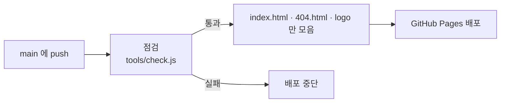

<p align="center">
  
</p>

<p align="center">서식 버튼과 도형 툴로 깃허브 README를 만드는 마크다운 에디터</p>

<p align="center"><b><a href="https://jobless-fish.github.io/md-editor/">https://jobless-fish.github.io/md-editor/</a></b></p>

## 무엇을 하나요

- 굵게·목록·표·알림 상자·접기 같은 서식을 버튼으로 넣습니다.
- 도형을 그리면 머메이드 코드가 만들어집니다. (순서도, 격자 배치, 깃 그래프)
- 오른쪽 코드 칸을 직접 고쳐도 왼쪽 편집 칸에 바로 반영됩니다.
- 설치 없이 브라우저에서 바로 쓰고, 작성한 내용은 내 브라우저에만 저장됩니다.

## 폴더 구성

| 경로 | 내용 | 사이트에 올라감 |
| :--- | :--- | :---: |
| `index.html` | 에디터 본체 (파일 하나) | ○ |
| `404.html` | 없는 주소로 들어왔을 때 보이는 화면 | ○ |
| `logo/` | 로고 SVG | ○ |
| `samples/` | 시험용 마크다운 | |
| `extras/` | 로고 애니메이션 시안 | |
| `tools/check.js` | 배포 전 점검 | |
| `.github/workflows/deploy.yml` | 자동 배포 설정 | |

## 배포

`main` 브랜치에 올리면 GitHub Actions가 점검한 뒤 GitHub Pages로 자동 배포합니다.



- 처음 한 번만 저장소 **Settings → Pages → Source**를 **GitHub Actions**로 바꿉니다.
- 진행 상황은 저장소의 **Actions** 탭에서 볼 수 있고, 같은 탭의 **Run workflow**로 직접 실행할 수도 있습니다.
- `README.md`, `samples/`, `extras/`만 바뀐 경우에는 배포하지 않습니다.

올리기 전에 내 컴퓨터에서 점검하려면 (Node.js 필요):

```
node tools/check.js
```

## 내 컴퓨터에서 열기

`index.html`을 브라우저로 열면 됩니다. 그림 미리보기는 머메이드를 인터넷에서 불러오므로 인터넷 연결이 필요합니다.
