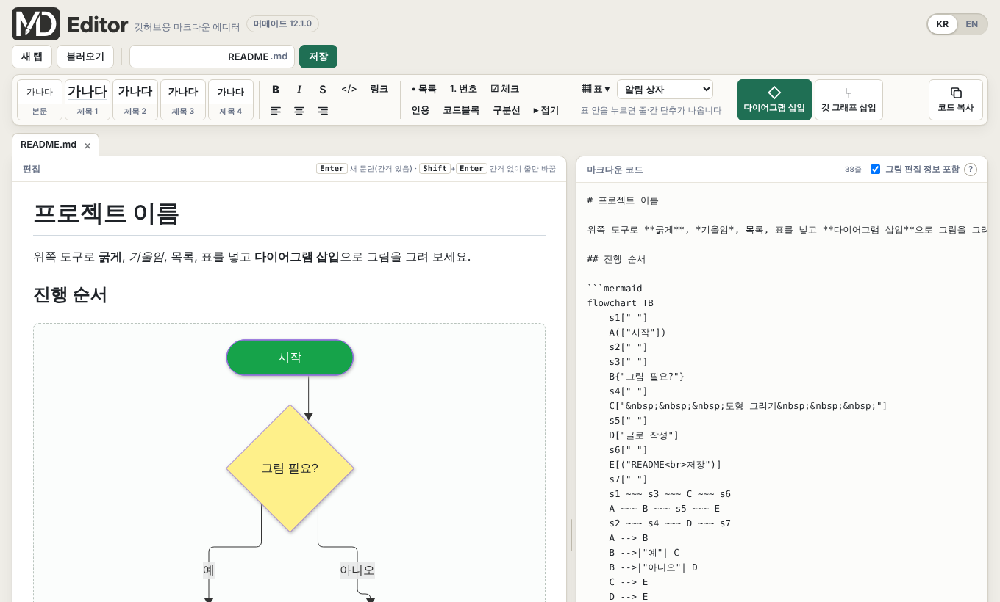
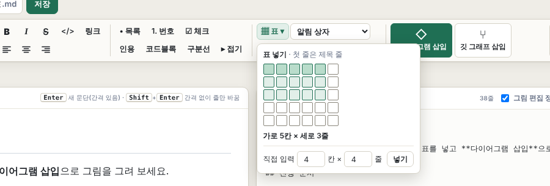
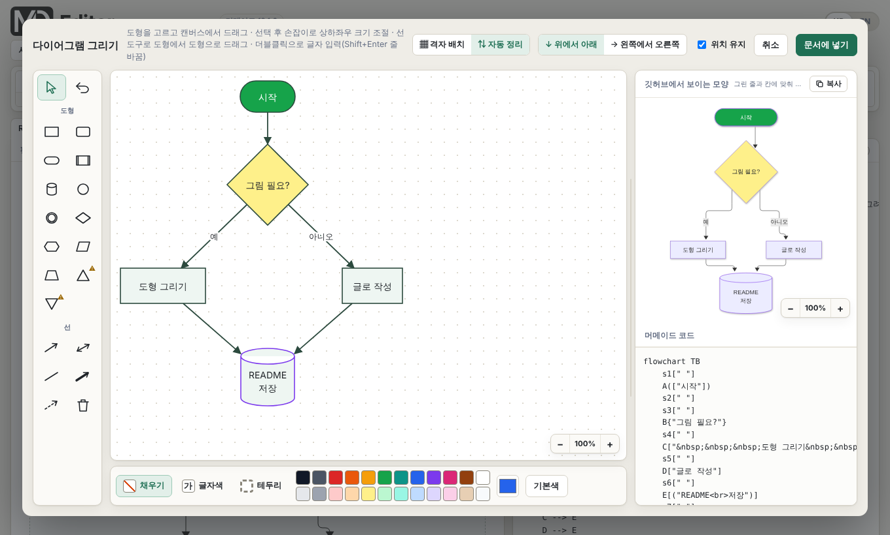
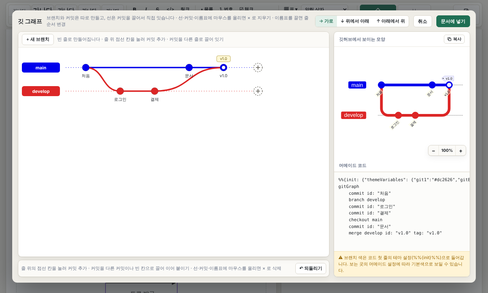
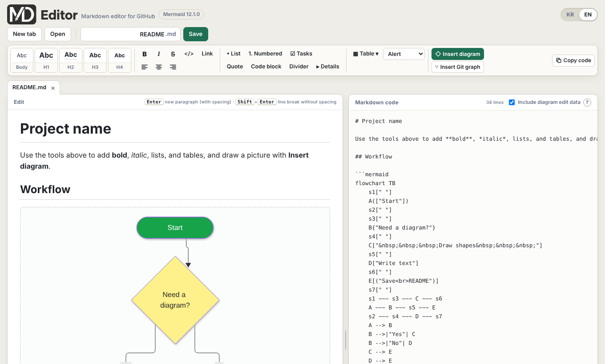
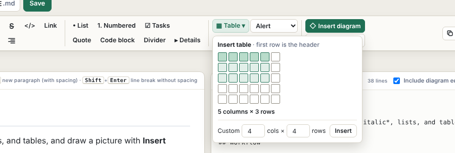
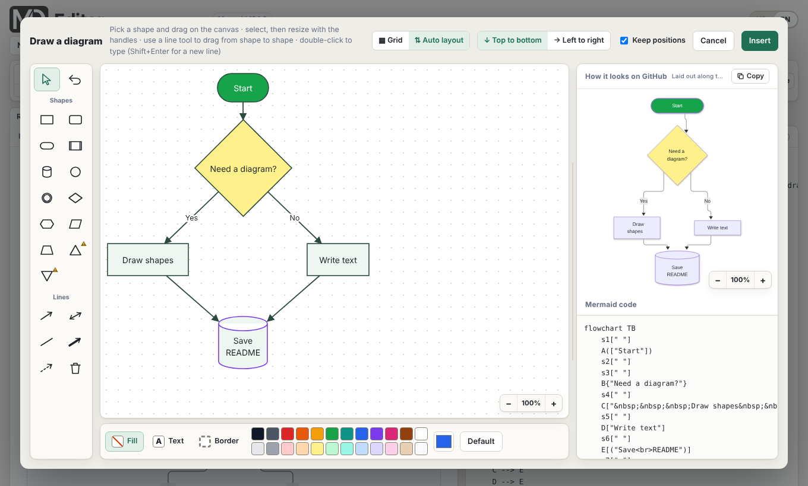
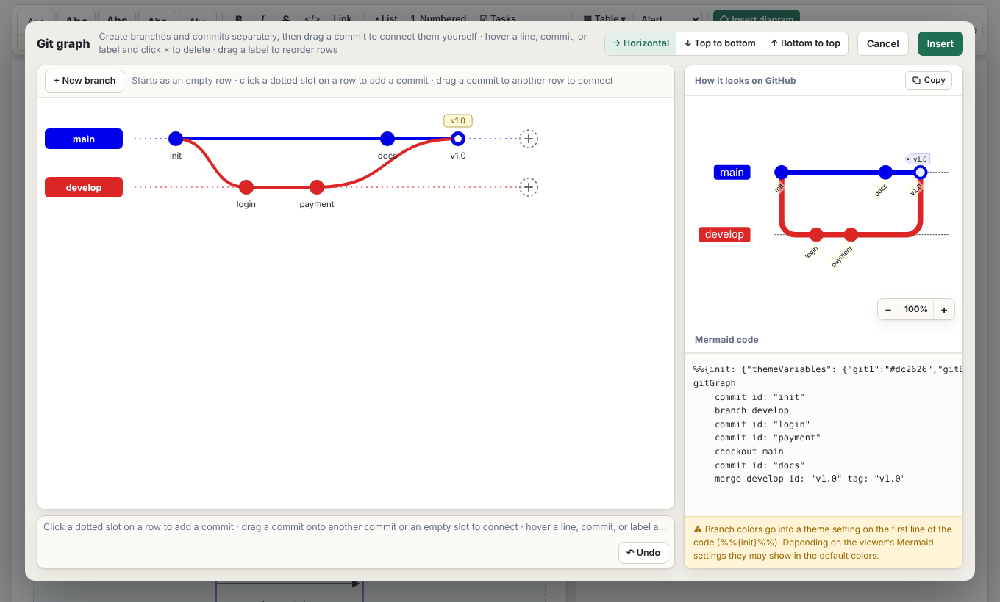

<a id="korean"></a>

<p align="center">
  
</p>

<p align="center"><b>한국어</b> · <a href="#english">English</a></p>

<p align="center">서식 버튼과 도형 툴로 깃허브 README를 만드는 마크다운 에디터</p>

<p align="center"><b><a href="https://jobless-fish.github.io/md-editor/">▶ 바로 사용하기</a></b></p>



## 이런 도구입니다

- 마크다운 기호를 외우지 않아도 됩니다. 굵게, 목록, 표, 알림 상자를 **버튼**으로 넣습니다.
- 순서도와 깃 그래프를 **그림판처럼 그리면** 머메이드 코드가 만들어집니다.
- 왼쪽에서 쓰면 오른쪽에 마크다운 코드가 바로 나오고, 오른쪽 코드를 고쳐도 왼쪽에 바로 반영됩니다.
- 설치와 가입이 없습니다. 쓴 글은 내 브라우저에만 보관됩니다.

## 3단계로 시작하기

1. [사이트](https://jobless-fish.github.io/md-editor/)를 열고, 로고 애니메이션이 끝나면 화면을 누릅니다.
2. 왼쪽 **편집** 칸에 글을 쓰고, 위쪽 도구모음으로 서식과 그림을 넣습니다.
3. 도구모음 오른쪽의 **코드 복사**를 눌러 깃허브의 README 편집 화면에 붙여 넣습니다.

> [!TIP]
> 붙여 넣은 뒤에는 깃허브의 **Preview** 탭에서 모양을 한 번 확인하세요. 그림은 깃허브가 쓰는 머메이드 버전에 따라 조금 다르게 보일 수 있습니다.

## 화면 구성

| 위치 | 하는 일 |
| :--- | :--- |
| 맨 위 오른쪽 **KR / EN** | 화면 언어를 한국어·영어로 바꿉니다 |
| **새 탭 · 불러오기 · 파일 이름 · 저장** | 문서를 만들고, `.md` 파일을 열고, 저장합니다 |
| **도구모음** | 서식, 표, 알림 상자, 다이어그램, 깃 그래프, 코드 복사. 화면을 내려도 위에 붙어 있습니다 |
| **탭** | 여러 문서를 열어 두고 오갑니다. 파일로 저장하지 않은 변경이 있으면 ●가 붙습니다 |
| 왼쪽 **편집** 칸 | 깃허브에서 보이는 모양으로 글을 씁니다 |
| 오른쪽 **마크다운 코드** 칸 | 만들어진 코드입니다. 직접 고칠 수도 있습니다 |

편집 칸과 코드 칸 사이의 세로 막대를 끌면 폭을 조절할 수 있고, 두 번 누르면 처음 폭으로 돌아갑니다.

## 글 쓰기와 서식

글을 선택하거나 커서를 둔 뒤 도구모음의 버튼을 누릅니다.

| 버튼 | 내용 | 단축키 |
| :--- | :--- | :--- |
| 본문 · 제목 1~4 | 문단을 본문이나 제목으로 바꿉니다. 글자 크기는 제목 단계로 조절합니다 | |
| **B** · *I* · ~~S~~ | 굵게 · 기울임 · 취소선 | Ctrl+B · Ctrl+I |
| `</>` | 글 중간 코드 (글자를 먼저 선택) | |
| 링크 | 선택한 글자에 주소를 겁니다 | |
| 정렬 | 왼쪽 · 가운데 · 오른쪽. 문단과 제목에 쓸 수 있습니다 | |
| 목록 · 번호 · 체크 | 글머리 목록, 번호 목록, 체크 목록 | |
| 인용 · 코드블록 · 구분선 | 인용문, 코드 블록, 가로줄 | |
| 접기 | 제목을 누르면 내용이 펼쳐지는 블록 | |
| 표 | 표 넣기 | |
| 알림 상자 | Note · Tip · Important · Warning · Caution | |

- **Enter**는 새 문단(위아래 간격 있음), **Shift+Enter**는 간격 없이 줄만 바꿉니다.
- **Ctrl+Z**로 되돌립니다.

### 표



- **표** 버튼을 누르고 칸 위를 훑어서 크기를 고릅니다. 처음에는 4×4가 보이고, 끝으로 가져가면 15×15까지 늘어납니다.
- 더 큰 표는 아래 **직접 입력**에 칸 수와 줄 수를 적습니다. (가로 30칸, 세로 200줄까지)
- 첫 줄은 제목 줄입니다.
- 표 안을 누르면 줄·칸 버튼이 나옵니다. 표 아래와 오른쪽의 **+** 로 줄과 칸을 늘리고, **−** 로 커서가 있는 줄과 칸을 지웁니다.
- 표 안에서 정렬 버튼을 누르면 그 칸이 속한 세로줄 전체가 정렬됩니다.

### 블록 지우기

표, 코드 블록, 구분선, 인용, 알림 상자, 접기 블록, 체크 항목에 마우스를 올리면 오른쪽 위에 **×** 가 나옵니다. 누르면 통째로 지워지고, Ctrl+Z로 되살릴 수 있습니다.

## 다이어그램 그리기

도구모음의 **다이어그램 삽입**을 누르면 그리기 창이 열립니다.



1. 왼쪽에서 도형을 고르고 캔버스에 끌어서 그립니다.
2. 선 도구를 고르고 도형에서 도형으로 끌어서 잇습니다.
3. 도형이나 선을 두 번 누르면 글자를 넣을 수 있습니다. (Shift+Enter로 줄 바꿈)
4. 아래 팔레트에서 **채우기 · 글자색 · 테두리** 색을 고릅니다.
5. 오른쪽에서 깃허브에 보일 모양과 머메이드 코드를 확인하고 **문서에 넣기**를 누릅니다.

넣은 그림은 편집 칸에서 눌러 언제든 다시 고칠 수 있습니다.

| 방식 | 특징 |
| :--- | :--- |
| **자동 정리** | 모든 도형을 쓸 수 있고 크기를 상하좌우로 조절합니다. 배치는 머메이드가 잡습니다. **위치 유지**를 켜면 그린 줄과 칸에 맞춰 줍니다 |
| **격자 배치** | 도형을 놓은 칸 위치가 그대로 유지됩니다. 크기는 가로 칸 수만 조절되고 삼각형은 없습니다 |

방향은 **위에서 아래** 또는 **왼쪽에서 오른쪽**을 고를 수 있습니다.

> [!NOTE]
> 삼각형과 역삼각형은 최신 머메이드 문법이라, 깃허브가 쓰는 버전에 따라 보이지 않을 수 있습니다.

## 깃 그래프 그리기

도구모음의 **깃 그래프 삽입**을 누릅니다.



- **+ 새 브랜치**로 줄을 만들고, 줄 위의 점선 칸을 눌러 커밋을 넣습니다.
- 커밋을 다른 줄의 커밋이나 빈 칸으로 **끌어서** 갈라지는 선과 병합선을 직접 잇습니다.
- 커밋을 누르면 이름, 태그, 모양(보통 · 강조 · 되돌림)을 바꿀 수 있습니다.
- 브랜치 이름표를 누르면 이름과 색을 바꾸고, 끌면 줄 순서를 바꿉니다.
- 선, 커밋, 이름표에 마우스를 올리면 나오는 **×** 로 지웁니다.
- 방향은 가로, 위에서 아래, 아래에서 위 중에서 고릅니다.

머메이드 규칙상 안 되는 연결(예: `main`의 첫 커밋으로 들어오는 선)은 이유를 알려 주고 막습니다.

## 코드 칸에서 직접 고치기

- 오른쪽 **마크다운 코드** 칸의 글자를 고치면 왼쪽 편집 칸에 바로 반영됩니다. 다른 곳에서 쓴 마크다운을 통째로 붙여 넣어도 됩니다.
- 시퀀스 다이어그램이나 간트 차트처럼 도형으로 그릴 수 없는 머메이드는 코드 칸에 ```` ```mermaid ```` 블록으로 적으면 그림으로 나옵니다. 이런 그림은 눌러서 코드로 고칩니다.
- **그림 편집 정보 포함**을 켜 두면, 그린 정보(도형 위치·크기·색)가 코드 끝에 주석 한 줄로 들어갑니다. 깃허브 화면에는 보이지 않고, 저장한 파일을 나중에 불러왔을 때 도형 그대로 다시 고칠 수 있게 해 줍니다. 끄면 코드가 깔끔해지는 대신 다시 불러왔을 때 코드로만 고칠 수 있습니다.

## 문서 탭 · 저장 · 불러오기

- **자동 보관**: 쓰는 내용은 브라우저에 자동으로 보관되어, 창을 닫았다 열어도 탭과 내용이 그대로 남습니다.
- **저장**: 이름 칸에 파일 이름을 적고 **저장**(Ctrl+S)을 누르면 저장할 위치를 고르는 창이 뜹니다. 이 창은 크롬·엣지 계열에서만 뜨고, 그 밖의 브라우저에서는 내려받기 폴더에 저장됩니다.
- **불러오기**: `.md` 파일을 새 탭으로 엽니다. 파일을 창에 끌어다 놓아도 됩니다. (3MB까지)
- **탭 닫기**: 저장하지 않은 변경이 있으면 저장할지 물어봅니다.

## 언어 바꾸기

화면 오른쪽 위의 **KR / EN** 에서 고릅니다. 고른 언어는 다음에 열 때도 유지됩니다. 주소 끝에 `?lang=en` 이나 `?lang=ko` 를 붙여서 열 수도 있습니다. 언어를 바꿔도 쓴 글은 그대로입니다.

## 알아 두면 좋은 점

- 깃허브의 README는 **글자 크기와 글자색**을 지원하지 않습니다. 크기는 제목 단계로 조절합니다.
- 깃허브의 마크다운 표는 **칸 병합**이 되지 않습니다.
- 목록과 코드 블록은 정렬할 수 없습니다.
- 그림 미리보기는 머메이드를 인터넷에서 불러오므로 **인터넷 연결**이 필요합니다.
- 화면 위의 **머메이드 12.x.x** 표시는 미리보기에 쓰는 머메이드 버전입니다. 깃허브가 쓰는 버전에 맞춰 두었고, 새 버전이 나오면 그림이 깨지는지 미리 점검해 알려 줍니다.

## 자주 묻는 질문

<details>
<summary>쓴 글은 어디에 저장되나요?</summary>

내 브라우저 안에만 보관되고 서버로 보내지 않습니다. 브라우저의 사이트 데이터를 지우면 함께 사라지므로, 중요한 문서는 **저장** 버튼으로 파일로 남겨 두세요.

</details>

<details>
<summary>다른 컴퓨터에서 이어서 쓸 수 있나요?</summary>

**저장**으로 `.md` 파일을 만든 뒤, 다른 컴퓨터에서 **불러오기**로 엽니다. 그림 편집 정보 포함을 켜 두었다면 그림도 도형 그대로 다시 고칠 수 있습니다.

</details>

<details>
<summary>어떤 브라우저에서 쓸 수 있나요?</summary>

크롬과 엣지 계열에서 만들고 확인했습니다. 다른 브라우저에서는 저장할 때 위치를 고르는 창 대신 내려받기로 저장됩니다.

</details>

<details>
<summary>깃허브에 붙였더니 그림이 다르게 보여요</summary>

깃허브가 쓰는 머메이드 버전이 미리보기와 다르면 그럴 수 있습니다. 화면 위의 머메이드 표시를 눌러 점검 결과를 확인해 보세요.

</details>

## 예정된 기능

- **ER 다이어그램(표 모양 머메이드)을 표처럼 고치기**: `erDiagram`처럼 표 형태로 그려지는 머메이드를, 편집 칸에서 표를 선택해 칸을 직접 고칠 수 있게 할 예정입니다. 지금은 코드로만 고칠 수 있습니다.

## 문의

버그나 바라는 기능은 이 저장소의 [Issues](../../issues)에 남겨 주세요. 개발과 배포에 관한 내용은 [README_DEV.md](README_DEV.md)에 있습니다.

## 저작권

© 2026 jobless-fish. All rights reserved.

- 사이트에서 이 도구를 쓰는 것은 무료이고, 이 도구로 만든 문서와 머메이드 코드는 만든 분의 것입니다. 자유롭게 쓰세요.
- 이 저장소의 코드, 디자인, 로고는 허락 없이 복제, 수정, 재배포하거나 다른 사이트에 올릴 수 없습니다.

자세한 내용은 [LICENSE](LICENSE)에 있습니다.

---

<a id="english"></a>

<p align="center">
  
</p>

<p align="center"><a href="#korean">한국어</a> · <b>English</b></p>

<p align="center">A Markdown editor for writing GitHub READMEs with formatting buttons and shape tools</p>

<p align="center"><b><a href="https://jobless-fish.github.io/md-editor/?lang=en">▶ Open the editor</a></b></p>



## What it is

- No Markdown syntax to memorize. Add bold text, lists, tables, and alerts with **buttons**.
- **Draw** flowcharts and Git graphs like in a paint program, and the Mermaid code is generated for you.
- Write on the left and the Markdown code appears on the right. Edit the code on the right and the left side updates right away.
- Nothing to install and no sign-up. What you write stays in your own browser.

## Get started in 3 steps

1. Open [the site](https://jobless-fish.github.io/md-editor/?lang=en) and click the screen once the logo animation finishes.
2. Write in the **Edit** pane on the left, and use the toolbar above for formatting and diagrams.
3. Click **Copy code** at the right end of the toolbar and paste it into the README editor on GitHub.

> [!TIP]
> After pasting, check the result once in GitHub's **Preview** tab. Diagrams can look slightly different depending on the Mermaid version GitHub uses.

## The screen

| Where | What it does |
| :--- | :--- |
| **KR / EN** at the top right | Switches the interface between Korean and English |
| **New tab · Open · file name · Save** | Create a document, open an `.md` file, and save |
| **Toolbar** | Formatting, tables, alerts, diagrams, Git graphs, and Copy code. It stays at the top when you scroll |
| **Tabs** | Keep several documents open. A ● marks changes not yet saved to a file |
| **Edit** pane on the left | Write the way it will look on GitHub |
| **Markdown code** pane on the right | The generated code. You can edit it directly |

Drag the vertical bar between the two panes to resize them; double-click it to reset.

## Writing and formatting

Select text or place the cursor, then click a toolbar button.

| Button | What it does | Shortcut |
| :--- | :--- | :--- |
| Body · H1–H4 | Turns the paragraph into body text or a heading. Use heading levels for text size | |
| **B** · *I* · ~~S~~ | Bold · italic · strikethrough | Ctrl+B · Ctrl+I |
| `</>` | Inline code (select the text first) | |
| Link | Adds an address to the selected text | |
| Alignment | Left · center · right. Works on paragraphs and headings | |
| List · Numbered · Tasks | Bulleted list, numbered list, task list | |
| Quote · Code block · Divider | Block quote, code block, horizontal rule | |
| Details | A collapsible section that expands when its summary is clicked | |
| Table | Inserts a table | |
| Alert | Note · Tip · Important · Warning · Caution | |

- **Enter** starts a new paragraph (with spacing); **Shift+Enter** breaks the line without spacing.
- **Ctrl+Z** undoes.

### Tables



- Click **Table** and sweep over the cells to pick a size. It starts at 4×4 and grows up to 15×15 as you reach the edge.
- For bigger tables, type the numbers under **Custom** (up to 30 columns and 200 rows).
- The first row is the header.
- Click inside a table to show the row and column buttons. Use the **+** bars below and to the right of the table to add rows and columns, and **−** to delete the row or column with the cursor.
- Clicking an alignment button inside a table aligns the whole column.

### Deleting blocks

Hover a table, code block, divider, quote, alert, details block, or task item and an **×** appears at its top right. Click it to delete the whole block; Ctrl+Z brings it back.

## Drawing diagrams

Click **Insert diagram** in the toolbar to open the drawing window.



1. Pick a shape on the left and drag on the canvas to draw it.
2. Pick a line tool and drag from one shape to another to connect them.
3. Double-click a shape or a line to type text (Shift+Enter for a new line).
4. Choose **Fill · Text · Border** colors from the palette below.
5. Check how it will look on GitHub and the Mermaid code on the right, then click **Insert**.

Click an inserted diagram in the Edit pane at any time to edit it again.

| Mode | Notes |
| :--- | :--- |
| **Auto layout** | Every shape is available and shapes can be resized in any direction. Mermaid decides the layout; turn on **Keep positions** to line shapes up by the rows and columns you drew |
| **Grid** | Shapes stay exactly in the cells you put them in. Only the width in cells can be changed, and there are no triangles |

The direction can be **Top to bottom** or **Left to right**.

> [!NOTE]
> Triangles and inverted triangles use newer Mermaid syntax and may not show depending on the version GitHub uses.

## Drawing Git graphs

Click **Insert Git graph** in the toolbar.



- Create rows with **+ New branch**, and click a dotted slot on a row to add a commit.
- **Drag** a commit onto a commit or an empty slot on another row to draw fork and merge lines yourself.
- Click a commit to change its name, tag, and type (normal · highlight · reverse).
- Click a branch label to rename or recolor it; drag it to reorder the rows.
- Hover a line, commit, or label and click the **×** to delete it.
- The direction can be horizontal, top to bottom, or bottom to top.

Connections that Mermaid does not allow (for example, a line into the first commit on `main`) are blocked with an explanation.

## Editing the code directly

- Edit the text in the **Markdown code** pane on the right and the Edit pane on the left updates right away. You can also paste in Markdown written elsewhere.
- Mermaid diagrams that cannot be drawn with shapes, such as sequence diagrams or Gantt charts, show up as pictures when you write them in a ```` ```mermaid ```` block in the code pane. Click such a picture to edit its code.
- With **Include diagram edit data** on, how each diagram was drawn (shape positions, sizes, colors) is stored as a one-line comment at the end of its code. It does not show on GitHub, and it lets you keep editing the shapes when you open the saved file later. Turning it off gives cleaner code, but after reopening you can only edit the diagram as code.

## Tabs, saving, and opening

- **Autosave**: what you write is kept in your browser automatically, so your tabs and content are still there after you close and reopen the window.
- **Save**: type a file name and click **Save** (Ctrl+S) to choose where to save. This dialog appears in Chrome and Edge based browsers; other browsers save to the Downloads folder instead.
- **Open**: opens an `.md` file in a new tab. You can also drop a file onto the window (up to 3 MB).
- **Closing a tab**: if there are unsaved changes, you are asked whether to save.

## Changing the language

Use **KR / EN** at the top right. Your choice is remembered next time. You can also open the site with `?lang=en` or `?lang=ko` at the end of the address. Switching languages does not change what you wrote.

## Good to know

- GitHub READMEs do not support **font sizes or text colors**. Use heading levels for size.
- GitHub Markdown tables do not support **merged cells**.
- Lists and code blocks cannot be aligned.
- Diagram previews load Mermaid from the internet, so an **internet connection** is required.
- The **Mermaid 12.x.x** badge at the top shows the Mermaid version used for previews. It is set to match the version GitHub uses, and when a new version comes out the editor checks in advance whether diagrams break with it.

## FAQ

<details>
<summary>Where is my writing stored?</summary>

Only inside your browser; it is not sent to a server. It is removed if you clear the browser's site data, so keep important documents as files with the **Save** button.

</details>

<details>
<summary>Can I continue on another computer?</summary>

Create an `.md` file with **Save**, then use **Open** on the other computer. If "Include diagram edit data" was on, the diagrams can be edited as shapes again.

</details>

<details>
<summary>Which browsers are supported?</summary>

It was built and checked in Chrome and Edge based browsers. In other browsers, saving goes to the Downloads folder instead of showing a save-location dialog.

</details>

<details>
<summary>A diagram looks different after pasting it into GitHub</summary>

That can happen when GitHub's Mermaid version differs from the preview. Click the Mermaid badge at the top of the screen to see the check results.

</details>

## Planned

- **Editing ER diagrams (table-shaped Mermaid) like a table**: Mermaid diagrams that render as tables, such as `erDiagram`, will become editable by selecting the table in the Edit pane and changing its cells directly. For now they can only be edited as code.

## Feedback

Please report bugs and feature requests in this repository's [Issues](../../issues). Development and deployment notes are in [README_DEV.md](README_DEV.md) (Korean).

## Copyright

© 2026 jobless-fish. All rights reserved.

- Using the tool on the site is free, and the documents and Mermaid code you create with it are yours to use freely.
- The code, design, and logo in this repository may not be copied, modified, redistributed, or hosted elsewhere without permission.

See [LICENSE](LICENSE) for details.
