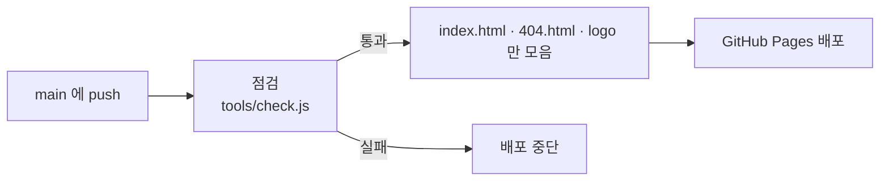

# MD Editor 개발 문서

사용 설명서는 [README.md](README.md)에 있습니다. 이 문서는 저장소 구성, 배포, 고칠 때 알아 둘 점을 적어 둔 것입니다.

사이트: <https://jobless-fish.github.io/md-editor/>

## 폴더 구성

| 경로 | 내용 | 사이트에 올라감 |
| :--- | :--- | :---: |
| `index.html` | 에디터 본체 (HTML·CSS·스크립트가 파일 하나에 모두 들어 있음) | ○ |
| `404.html` | 없는 주소로 들어왔을 때 보이는 화면 | ○ |
| `logo/` | 로고 SVG (전체, 배지만) | ○ |
| `README.md` | 사용 설명서 (한국어, 영어) | |
| `docs/images/ko`, `docs/images/en` | 사용 설명서에 쓰는 화면 사진 | |
| `samples/` | 시험용 마크다운 (한국어, 영어) | |
| `extras/` | 로고 애니메이션 시안 | |
| `tools/check.js` | 배포 전 점검 | |
| `.github/workflows/deploy.yml` | 자동 배포 설정 | |

## 배포

`main` 브랜치에 올리면 GitHub Actions가 점검한 뒤 GitHub Pages로 자동 배포합니다.



- 처음 한 번만 저장소 **Settings → Pages → Source**를 **GitHub Actions**로 바꿉니다.
- 진행 상황은 저장소의 **Actions** 탭에서 볼 수 있고, 같은 탭의 **Run workflow**로 직접 실행할 수도 있습니다.
- `README.md`, `README_DEV.md`, `docs/`, `samples/`, `extras/`만 바뀐 경우에는 배포하지 않습니다.

올리기 전에 내 컴퓨터에서 점검하려면 (Node.js 필요):

```
node tools/check.js
```

점검하는 것: 필요한 파일이 있는지, 스크립트 문법, `/`로 시작하는 경로(주소가 `/md-editor/` 아래라서 깨짐), `http://`로 불러오는 파일, 영어 번역이 빠진 글자.

## 내 컴퓨터에서 열기

`index.html`을 브라우저로 열면 됩니다. 그림 미리보기는 머메이드를 인터넷에서 불러오므로 인터넷 연결이 필요합니다.

## 고칠 때 알아 둘 점

### 언어 (한국어 / 영어)

- 언어는 페이지 맨 앞의 짧은 스크립트가 정합니다. 순서는 주소의 `?lang=en|ko` → 지난번에 고른 것(`localStorage`의 `mdpaint.lang`) → 브라우저 언어(한국어가 아니면 영어)입니다.
- 스크립트에서 화면에 보이는 글자는 한국어 원문을 `__()`로 감싸 씁니다. 영어일 때는 `EN` 표에서 같은 원문을 찾아 바꿉니다. 값이 들어가는 자리는 `{0}`, `{1}`로 적습니다.

  ```js
  toast(__('마크다운을 복사했습니다'));
  toast(__('{0} 파일로 저장했습니다', name));
  ```

- HTML에 처음부터 적혀 있는 글자(버튼 이름, 풍선 설명)는 `EN_HTML` 표에 한국어 → 영어로 적어 두면 영어 화면에서 한 번에 바뀝니다. 같은 글자가 버튼 이름과 풍선 설명에 따로 쓰이면 설명 쪽은 `'@원문'`으로 적습니다.
- **새 글자를 넣을 때는 두 표 중 맞는 곳에 영어를 한 줄 추가해야 합니다.** 빠뜨리면 영어 화면의 콘솔에 경고가 나오고, `tools/check.js`가 배포를 막습니다.
- 언어를 바꾸면 문서를 보관한 뒤 화면을 다시 불러와 처음부터 그 언어로 그립니다. 손대지 않은 예시 문서는 새 언어의 예시 문서로 바뀌고, 쓴 글은 그대로 둡니다.
- 머메이드 점검용 그림(`canaryList`)의 글자는 한글이 그려지는지 보려는 시험 자료라 일부러 번역하지 않습니다.

### 머메이드 버전

- 미리보기는 깃허브가 쓰는 버전에 맞춰 고정해 둡니다 (`MM_PIN`). 깃허브의 버전은 README에 `info` 그림을 넣어 확인합니다.
- 하루에 한 번 npm의 최신 버전을 확인하고, 새 버전이 있으면 숨은 창에서 점검용 그림을 그려 봅니다. 결과는 화면 위의 머메이드 표시에 나옵니다.
- 깃허브가 버전을 올린 것이 확인되면 `MM_PIN`을 그 버전으로 바꿉니다.

### 브라우저에 보관하는 것

| 키 | 내용 |
| :--- | :--- |
| `mdpaint.tabs.v1` | 열려 있는 탭과 문서 |
| `mdpaint.lang` | 고른 언어 |
| `mdpaint.mm`, `mdpaint.mmcheck` | 미리보기 머메이드 버전, 새 버전 점검 결과 |
| `mdpaint.wsplit`, `mdpaint.mode`, `mdpaint.side`, `mdpaint.embed` | 칸 폭, 그리기 방식, 그리기 창 폭, 그림 편집 정보 포함 여부 |

키 이름과 머메이드 주석(`%% mdpaint:`)의 `mdpaint`는 예전 이름이지만, 이미 저장된 문서와 맞추기 위해 그대로 둡니다.

### 그 밖에

- 첫 화면(로고)은 페이지를 열 때마다 나옵니다. 언어를 바꿔 다시 불러올 때만 건너뜁니다.
- 저장은 `showSaveFilePicker`가 있는 브라우저(크롬·엣지 계열)에서는 저장 위치를 고르는 창을 띄우고, 없으면 내려받기로 저장합니다.

## 할 일

- [ ] **ER 다이어그램을 표처럼 고치기**: `erDiagram`처럼 표 모양으로 그려지는 머메이드를 편집 칸에서 표를 선택해 칸(자료형, 이름, 키, 설명)을 직접 고치게 하기. 지금은 코드로만 고칠 수 있음.
- [ ] 순서도 코드를 도형 편집 화면으로 불러오기 (편집 정보 주석이 없는 `flowchart` 코드를 읽어 도형으로 배치)
- [ ] GitHub Actions로 머메이드 새 버전과 깃허브가 쓰는 버전을 자동 확인하기
- [ ] 로고 애니메이션(`extras/logo-animation.html`)을 지금 로고 모양에 맞추기
