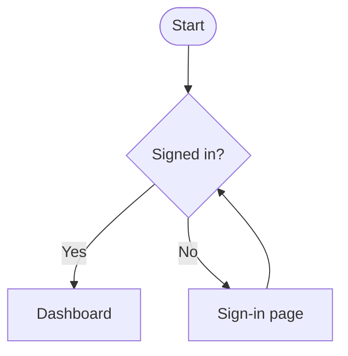
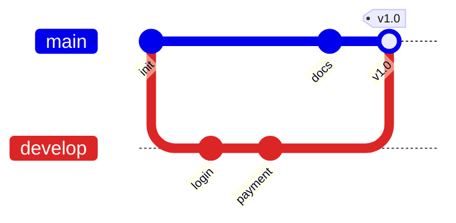
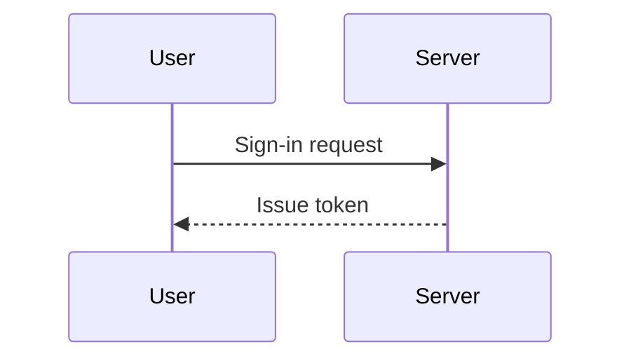

# Test document

Paste this into the code pane to check that it shows up as-is in the editor on the left. It contains **bold**, *italic*, ~~strikethrough~~, `inline code`, and a [link](https://github.com).

<p align="center">A centered paragraph.</p>

## Lists

- First bullet
- Second bullet
  - Nested item

1. Number one
2. Number two

- [x] Done
- [ ] To do

## Table

| Name | Qty | Price |
| :--- | :---: | ---: |
| Apple | 3 | 1,500 |
| Pear | 1 | 2,000 |

## Alerts

> [!NOTE]
> Something worth knowing.

> [!WARNING]
> Something to watch out for.

## Collapsible section

<details>
<summary>Click to expand</summary>

This content was folded away.

```bash
npm install
```

</details>

---

## Flowchart



## Git graph



## Sequence (code only)



> A block quote.
