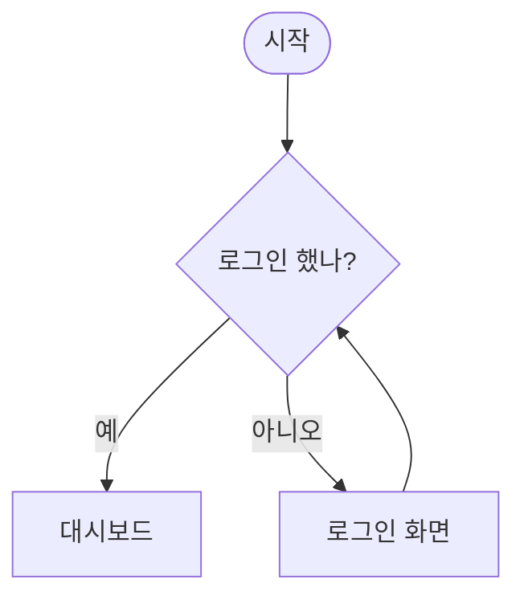
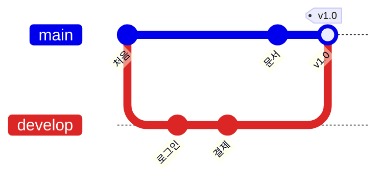
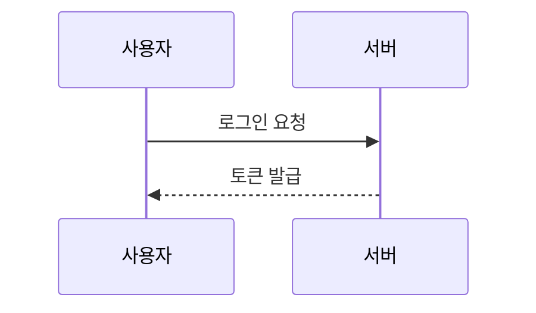

# 테스트 문서

코드 칸에 붙여 넣으면 왼쪽 편집 칸에 그대로 나타나는지 확인하는 문서입니다. **굵게**, *기울임*, ~~취소선~~, `글 중간 코드`, [링크](https://github.com) 가 들어 있습니다.

<p align="center">가운데 정렬한 문단입니다.</p>

## 목록

- 글머리 하나
- 글머리 둘
  - 안쪽 항목

1. 번호 하나
2. 번호 둘

- [x] 끝낸 일
- [ ] 남은 일

## 표

| 이름 | 수량 | 가격 |
| :--- | :---: | ---: |
| 사과 | 3 | 1,500 |
| 배 | 1 | 2,000 |

## 알림 상자

> [!NOTE]
> 참고할 내용입니다.

> [!WARNING]
> 주의할 내용입니다.

## 접기

<details>
<summary>눌러서 펼치기</summary>

접혀 있던 내용입니다.

```bash
npm install
```

</details>

---

## 순서도



## 깃 그래프



## 시퀀스 (코드로만 편집)



> 인용문입니다.
